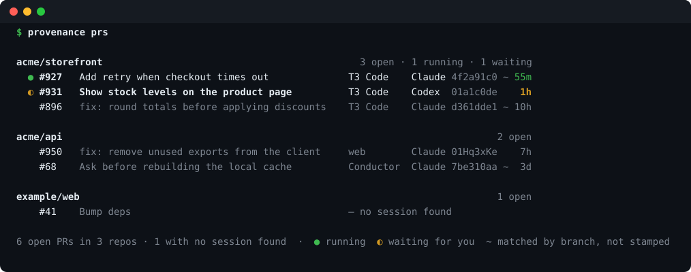

<div align="center">

# provenance

**Which agent session opened this PR, and is it still running?**

[](https://github.com/singular-machines/provenance/actions/workflows/ci.yml)     [](#license)

[Quick start](#quick-start) · [Reading the table](#reading-the-table) · [How it works](#how-it-works) · [Install hooks](#install-hooks) · [Privacy](#privacy) · [Roadmap](#roadmap) · [License](#license)



</div>

You run Claude Code, Codex and OpenCode in lots of apps: the terminal, Claude desktop, Codex desktop, T3 Code, Conductor, the web. They all open PRs. On GitHub you can't tell which session opened a PR, or whether that session is still alive.

`provenance prs` lists your open PRs with the session behind each one: the app it runs in, when it was last active, and whether it's running or waiting for you.

## Highlights

- **Works with nothing installed.** It reads the session logs Claude Code and Codex already write, and OpenCode's session database.
- **Exact matches with stamps.** An optional git hook adds `Agent-Session` trailers to agent commits. Claude Code on the web's `Claude-Session` trailers are read too.
- **Live status.** Session hooks show whether each session is running, waiting for you, stopped or ended.
- **Every app.** Terminal, Claude desktop, Codex desktop, T3 Code, Conductor and the web.
- **Fast.** Cached repeat runs take well under a second.
- **Private by default.** Commit stamps carry a random machine ID, never your host name.
- **Terminal only.** One Rust binary plus the GitHub CLI. `--json` for scripts and agents.

## Quick start

```sh
cargo install --git https://github.com/singular-machines/provenance
gh auth status          # provenance uses your existing gh login
provenance prs          # your open PRs and the session behind each
provenance install      # optional: exact stamps and live status
```

## Usage

| Command | What it does |
|---|---|
| `provenance prs` | Your open PRs across GitHub |
| `provenance prs --repo owner/name` | One repository |
| `provenance prs --author someone` | Someone else's PRs |
| `provenance prs --verbose` | Also count matches by stamp, repo and folder path |
| `provenance prs --json` | Every matching session per PR, for scripts and agents |
| `provenance prs --refresh` | Search GitHub now instead of using the 2-minute cache |
| `provenance install` / `uninstall` | Add or remove the commit-stamp and session hooks |
| `provenance machine [alias]` | Show or set this machine's name in stamps |

## Reading the table

PRs are grouped by repository, live sessions first. Each row reads: status, PR, title, app, harness and session ID, then when the session was last active.

| Mark | Meaning |
|---|---|
| `●` green | Running: working on a turn, and its process is up |
| `◐` yellow | Waiting for you: finished its turn |
| `✕` red | Stopped: was mid-turn when its process disappeared |
| `○` | Ended: the session was closed |
| dimmed row | No live session |
| `~` | Matched by branch, not by a commit stamp |

Status marks need [`provenance install`](#install-hooks) for Claude Code and Codex. OpenCode sessions get them from OpenCode's own database, with nothing installed: an idle OpenCode session shows as waiting while OpenCode is running, and one left busy shows as stopped once no OpenCode process runs. OpenCode sessions never show as running, because a surviving OpenCode service can't tell provenance whether that session's turn is still going. In a terminal, PR numbers are links to the PRs, and web session IDs link to the sessions. Titles use the terminal's width. Piped output is plain text, and `NO_COLOR` turns colour off.

## How it works

`provenance prs` lists your open PRs through `gh` and links each one to sessions in three ways, strongest first. The table marks `repo` and `path` matches with `~`; `--json` gives the `kind` of every match.

| Match | How |
|---|---|
| `stamp` | A commit in the PR names the session: `Agent-Session: <harness>/<id>` (written by provenance's git hook) or `Claude-Session: https://claude.ai/code/session_…` (written by Claude Code on the web). |
| `repo` | The session was on the PR's head branch, in a folder whose GitHub remotes (or the repository Codex logged) include the repository that branch lives in: the fork for a fork PR, otherwise the PR's repository. |
| `path` | Same, but the folder has since been deleted and its path names that repository, as in `…/conductor/workspaces/<repo>/<workspace>`. |

Branch matches come from the harnesses' own session logs, so they work with nothing installed:

| Harness | Logs | What it records |
|---|---|---|
| Claude Code | `~/.claude/projects/**/*.jsonl` | `gitBranch` and `cwd` on every message; `entrypoint` (`cli`, `claude-desktop`, `sdk-ts`) |
| Codex | `~/.codex/sessions/**/*.jsonl` | `git.branch` and `git.repository_url` once, when the session starts; `originator` (`T3 Code`, `Codex Desktop`, `codex-tui`, …) |
| OpenCode | `~/.local/share/opencode/opencode.db` (read with `sqlite3`, read-only) | The session's folder and its busy and idle times, but no git branch. A session is given the branch its folder has checked out now, and only if it's that folder's most recent session. |

- PRs whose head branch is a repository's configured default branch, `main`, `master` or the PR's own base are never branch-matched, because many unrelated sessions share those branches. Stamps still count.
- The time at the end of each row is the session's last logged event, or the stamped commit's time for sessions not on this machine.
- Apps built on the agent SDKs report a generic entrypoint, so they're named from their worktree folder: `.t3/worktrees` → T3 Code, `conductor/workspaces` → Conductor.
- Sessions known only from a stamp show where they ran: `web`, or `on <machine>`.

## Install hooks

`provenance install` is optional. It makes matches exact and adds live status. OpenCode needs only the git hook: its live status comes from its database. `provenance uninstall` removes the hooks it added; it leaves the settings backups, your machine name, the live-session records and the caches.

> [!TIP]
> Codex asks you to review new hooks before it runs them. Approve the provenance hooks when it asks.

<details>
<summary><b>What <code>install</code> changes</b></summary>

1. **A git hook that stamps agent commits.** It adds `hook.provenance` to your global git config: a config-defined `prepare-commit-msg` hook, which git runs alongside each repository's own hooks (including repositories with their own `core.hooksPath`), so nothing is displaced. When a commit is made inside a Claude Code, Codex or OpenCode session (`CLAUDE_CODE_SESSION_ID`, `CODEX_THREAD_ID` or `OPENCODE_SESSION_ID` is set), it adds `Agent-Session` and `Agent-Machine` trailers. Commits you make yourself are left alone. When one harness runs inside another's shell and both variables are set, the stamp names the harness whose process is nearest up the process tree, not the outer one. Needs a git that supports hooks defined in config (`hook.<name>.command`, as in git 2.56); `install` checks and refuses otherwise.
2. **Session hooks for Claude Code and Codex** (`SessionStart`, `UserPromptSubmit`, `PostToolUse`, `Stop`, `SessionEnd`) in `~/.claude/settings.json` and `~/.codex/hooks.json`, appended after your existing hooks; a backup is written first and the file keeps its permissions. `uninstall` removes only provenance's own commands. In Codex, which keys hook approvals by position, a removed group that has later groups after it keeps a no-op `true` command so those later hooks keep their approvals. Each event updates `~/.local/state/provenance/live/<harness>-<id>.json`: the harness process ID and its start time, the last event, and every folder and branch the session has been on. That gives the status marks described in [Reading the table](#reading-the-table).

</details>

## Privacy

> [!NOTE]
> Stamps never contain your host name. Each machine gets a random ID such as `m-7f3a9c2e`, created on first use and kept in the global git setting `provenance.machine`.

- `provenance machine <alias>` sets a name of your choice (letters, digits, `.`, `-`, `_`). `provenance machine` shows the current one.
- `PROVENANCE_MACHINE` overrides it for one shell.
- Stamps are part of commit history. On public repositories they publish the session ID and this machine name.
- Everything else stays on your machine: session logs are read locally, and nothing is sent anywhere except `gh` queries to GitHub.

## Speed

Caches live in `~/.cache/provenance/`, and deleting that folder is always safe.

| Cache | Kept until |
|---|---|
| PR list | 2 minutes; the footer says how old it is, and `--refresh` skips it |
| Commit stamps | The PR's head or base moves |
| Session logs | The log file's size or modified time changes |

## Known gaps

- **Unstamped sessions on other machines.** A session that ran elsewhere is found only through its commit stamps, and shows as `web` or `on <machine>` with the stamped commit's time but no live status. Without a stamp it shows "no session found".
- **Without `install`:** a Codex session that starts on `main` and then creates the PR branch isn't matched (Codex logs its branch only at session start), and nor is a session that works in another repository by changing directory. Stamps and session hooks cover both.
- **A repository's own `prepare-commit-msg` runs after provenance's.** One that rewrites the whole message would drop the stamp.
- **Desktop apps start a new harness process per turn** (Conductor does; others may), so between turns a waiting session has no process of its own. The status relies on the last event for that reason.
- **Stamps only cover commits made after install.**
- **OpenCode records no git branch.** Without a stamp, an OpenCode session is matched only on the branch its folder has checked out now, and only if it's that folder's most recent session.

## Roadmap

- [x] `provenance prs` from existing session logs
- [x] Commit stamps (including Claude Code on the web's) and live session status
- [ ] `provenance show`, `go` (reopen the session) and `send` (steer it through Singular)
- [ ] An MCP server exposing the same functions to agents

## License

Licensed under either of [Apache License, Version 2.0](LICENSE-APACHE) or [MIT license](LICENSE-MIT), at your option.

Unless you explicitly state otherwise, any contribution intentionally submitted for inclusion in this work, as defined in the Apache-2.0 license, shall be dual licensed as above, without any additional terms or conditions.
